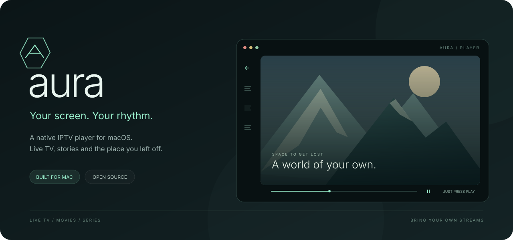
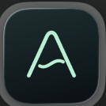

<div align="center">
  
  <br />
  
  <br /><br />
  <strong>macOS 14+ &nbsp; · &nbsp; Apple Silicon &nbsp; · &nbsp; SwiftUI &nbsp; · &nbsp; mpv &nbsp; · &nbsp; GPL-3.0-or-later</strong>
  <br /><br />
  <a href="#features">Features</a> &nbsp; / &nbsp;
  <a href="#build--run">Build &amp; run</a> &nbsp; / &nbsp;
  <a href="docs/PRIVACY.md">Privacy</a> &nbsp; / &nbsp;
  <a href="docs/DISCLAIMER.md">Disclaimer</a>
</div>

<br />

## A quieter place to watch

**Aura** is a native macOS IPTV player that brings live television, movies, series and your viewing progress into one calm interface. A dark palette, mint accents and focused playback controls keep the experience simple while leaving the useful tools close at hand.

Connect your own **Xtream Codes** account or **M3U/M3U8** playlist, browse your library and pick up where you left off.

> **Aura is a media player only.** It does not provide or sell IPTV broadcasts, TV channels, subscriptions, or provider access. Users must supply their own lawful sources. No provider accounts or service API keys are included. The sample collection uses public test streams and attributed demo media.

## Features

| Watch | Organize | Make it yours |
| :--- | :--- | :--- |
| Live TV, movies and series | Multiple Xtream and M3U sources | Remembered audio/subtitle languages |
| mpv playback with VideoToolbox | Continue watching and recently watched | Local and online subtitles |
| EPG with automatic launch refresh | Episode progress and season browsing | Mini player, fullscreen and sleep timer |
| Three live buffering profiles | Favorites and category filters | 5- or 10-second skip controls |
| Reconnect and HLS-to-TS fallback | Search after a 500 ms typing pause | Playback speed and aspect-ratio controls |

### Live TV that fits your connection

- **Lowest latency** — a 3-second forward-buffer target and the newest available HLS segment.
- **Balanced** — an 8-second buffer target with more room for network variation.
- **Smoothness first** — a 30-second buffer target for a larger safety margin.

Resuming a paused live stream reconnects to the current broadcast instead of replaying the old paused buffer. Buffer targets are **not** measurements or guarantees of end-to-end broadcast delay; the provider, segment duration and network still determine how close you can get to live.

### A library that remembers

Movies and episodes retain their playback position. Home shelves show artwork for recent and unfinished viewing; episode pages include progress indicators. Audio language, subtitle language and subtitle-off preferences carry forward when matching tracks are available.

### Subtitles, without the guesswork

Use embedded subtitles or add SRT, VTT, ASS or SSA files for on-demand content. Optional **OpenSubtitles.com** integration searches by title, language, season and episode using your own API key. Live TV uses the subtitle tracks supplied by the broadcast.

### More when you need it

- Up to four simultaneous live views, subject to your provider's connection limit.
- Live recording to MKV and scheduled recording while Aura is open and the Mac is awake.
- Downloads for direct movie/episode files; offline HLS packaging is not implemented.
- Provider-supported catch-up, local reminders and provider-based adult-content filtering.
- Optional Trakt scrobbling with your own application credentials.
- Optional folder-based synchronization of favorites and watch progress between Macs.
- An alternative AVKit playback mode for compatible streams, AirPlay and system picture-in-picture.

## Build & run

This repository is a **source release**. It does not distribute a prebuilt application, media-engine binaries or personal configuration files.

### Requirements

- macOS 14 or later on Apple Silicon.
- Xcode Command Line Tools with Swift 5.10 or later.
- Python 3, `curl` and the standard macOS packaging tools.

```sh
git clone https://github.com/KaridesFisher/Aura.git
cd Aura

# Fetch the pinned playback libraries from the official IINA release.
# The download is verified against a pinned SHA-256 checksum.
./Scripts/fetch-dependencies.sh

# Run the core checks, then build the application archive.
./Scripts/check.sh
./Scripts/build.sh

# Install the application in /Applications.
./Scripts/install.sh
```

The build produces `dist/Aura-Mac.zip`. Installation location can be overridden with `AURA_INSTALL_DIR`. The local build is ad hoc signed; it is not a Developer ID-signed or notarized distribution. Rebuilding may cause macOS to request Keychain access again.

### Connect a source

Open Aura and use **Add source** to enter your Xtream server, username and password, or import an M3U/M3U8 playlist. No account from the author is required or provided. The current application interface is primarily Turkish.

For optional subtitles and scrobbling, enter your own OpenSubtitles or Trakt application credentials in Settings. Service availability, account requirements and quotas are controlled by those services.

## Privacy by design

- Provider credentials, service tokens and the storage key are stored in **macOS Keychain**.
- The catalog, preferences and personal library are stored locally with **AES-GCM encryption**.
- No developer-operated telemetry or analytics endpoint is configured in this source release.
- Requests go directly to sources and optional services you choose. Remote artwork and public demo streams also contact their hosts.
- Folder synchronization is optional. Its personal-library JSON is **not encrypted by Aura** and can include viewing history, favorites and custom names; account passwords are excluded.
- This public repository excludes local account data, credentials, caches, logs, recordings, downloads, development build products and the previous local test notes.

Read the [privacy and data-flow notes](docs/PRIVACY.md) and the [publication audit scope](docs/PUBLICATION.md). Source publication does not grant access to anyone's Keychain or locally stored library.

## Project status & known limitations

**Early development.** Aura is a personal software project, not a commercial service or a promise of uninterrupted playback.

- **Known playback issue:** live video can drop frames when interacting with the macOS menu/title bar, particularly around fullscreen presentation. This remains unresolved; it is not advertised as fixed.
- Provider quality, EPG accuracy, content rights, archive availability and connection limits are outside the player's control.
- HDR/Dolby Vision output, Dolby Atmos passthrough and perfect audio/video synchronization are not guaranteed.
- AVKit mode has different format and subtitle capabilities from mpv; the mpv-specific track/external-subtitle controls do not carry into AVKit.
- Scheduled recording requires an open application and an awake Mac. Interrupted direct downloads restart from the beginning.
- There is no iPhone, Android or Apple TV application in this repository.
- The core checks cover parsing, transport fixtures, preferences-related logic and library behavior. They are not proof of flawless playback on every stream or device.

## Development

```text
Sources/Aura/       Native macOS interface, persistence and playback coordination
Sources/AuraCore/   Models, parsers, service clients and shared playback policies
Sources/CMPV/       Dynamic adapter for the public libmpv API
Tests/             Core checks using synthetic data
Scripts/           Build, installation and local test helpers
docs/              Privacy, disclaimer, licensing and publication notes
```

The optional local fixture runs at loopback using **synthetic `demo` / `demo` credentials**:

```sh
python3 Scripts/offline-fixture.py
```

These are test values, not a working IPTV subscription. Before contributing, read [CONTRIBUTING.md](CONTRIBUTING.md) and [SECURITY.md](SECURITY.md). Do not attach account files, unredacted stream URLs or credentials to issues.

## Disclaimer

**Use Aura at your own risk.** To the fullest extent permitted by applicable law, the author and contributors provide the software without warranties and accept no liability for losses or damages arising from its use or inability to use it, including content access, third-party services, data loss or interrupted playback. Users are responsible for their sources, permissions, subscriptions and compliance with applicable law and service terms.

See the [full disclaimer](docs/DISCLAIMER.md). This notice does not remove rights or liabilities that applicable law does not allow to be excluded.

## License & acknowledgments

Aura source code is available under **[GNU GPL v3 or later](LICENSE)**. Media and third-party components retain their respective licenses; see [third-party notices](docs/THIRD-PARTY-NOTICES.txt).

Built with SwiftUI, mpv and FFmpeg. The dependency helper retrieves media libraries from the official IINA release; no IINA interface or application executable is included. Demo media is attributed to Blender Foundation / Blender Studio and the relevant film teams. Aura is an independent project.
